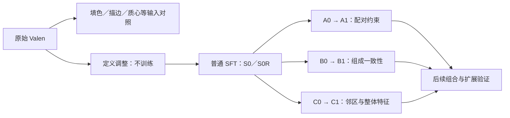

# 实验计划总览

| 类别 | 实验 | 对照关系／验证目的 | 状态 |
|---|---|---|---|
| 基础对照 | OOAL／原始 Valen | 建立统一 UMD 基线 | 已完成 |
| 基础对照 | Affordance-R1／zero-shot | 官方 prompt＋已知物体类别；比较全部功能与给定操作两种口径 | 已完成 |

| 无训练输入 | 填色 vs 仅描边 | 相同模型与 mask，检查填色干扰 | 已完成 |
| 无训练输入 | 功能定义调整 | 对比原始定义，检查混合区域与 none 的理解 | 已完成 |
| 无训练输入 | 质心点判断 | 对比填色基线，改为逐候选的单点定位 | 已完成 |
| 无训练前景 | Valen 选择完整物体 | 对比通用词表＋几何前景；后续固定质心点 yes/no | 已完成 |
| 无训练前景 | 互斥区域＋内部中心点并集 | 先消除重叠、合并小碎片，再逐点判断目标归属；对照几何及描边前景 | 9 张／18 功能对已完成；未启动全量 |
| 无训练前景 | 内部中心点＋96% 接收阈值 | 仅提高前景 P(yes) 门槛；部件分割及功能判断规则不变，对照原 50% 阈值 | 同样例 9 张／18 功能对已完成 |
| 无训练前景 | 96% 前景＋五种 Valen 全量对照 | 相同新前景与部件候选；五种功能判断重新推理，SFT 沿用权重 | 已完成：2,661 张／每组 5,232 对 |
| 无训练前景 | 完整词表＋几何筛选 baseline | 复用最早分割候选，补跑相同质心点功能判断，与三种通用词表前景方案比较 | 同样例 9 张／18 功能对已完成 |
| 无训练输入 | 编号外移 | 对比区域内编号，检查文字遮挡 | 未开展 |
| 无训练输入 | ICL 正例／正反例 | 对比无示例输入，检查上下文引导 | 未开展 |
| 监督训练 | 普通 SFT：S0／S0R | 对比相同定义的未训练模型；S0R 为本轮训练对照 | 已完成 |
| 监督训练 | A0／A1：配对约束 | A0 仅增强；A1 再加区域／定义配对与一致性 | 已完成 |
| 监督训练 | B0／B1：组成监督 | B0 几何变体＋组成监督；B1 再加组成一致性 | 已完成 |
| 监督训练 | C0／C1：区域上下文 | C0 仅目标特征；C1 再加邻区与整物体特征 | 已完成 |
| 组合方法 | A＋B 联合 | 检查两类训练约束是否互补 | 未开展 |
| 组合方法 | 训练改进＋区域特征 | 检查训练约束与 C 的特征接入能否叠加 | 未开展 |
| 诊断 | GT 多数类别赋类 | 固定 mask，区分候选质量与分类错误 | 已完成 |
| 诊断 | 原始 object＋part oracle | 完整 RGB、各 50 个候选；对比具体词表与通用词表，排除本地前景及候选整理的影响 | 已完成 |
| 诊断 | 前景／裁剪／过滤阶段消融 | 固定词表与前景逐项加入处理；另仅替换前景，验证主要损失来源 | 已完成 |
| 扩展验证 | 独立鲁棒性测试 | 区域／定义置换、编号变化与候选粒度变化 | 未开展 |
| 扩展验证 | 轻量头／CLIP 对照 | 同候选下检查大模型知识的作用 | 未开展 |
| 扩展验证 | 生成式 VLM 对照 | 同候选下比较判断精度与完整链路耗时 | 未开展 |
| 扩展验证 | 少样本预算曲线 | 比较 25%／50%／100% 训练预算 | 未开展 |
| 扩展验证 | 标注来源分析 | 检查人工／自动标注的影响 | 未开展 |
| 扩展验证 | 多种子实验 | 检查训练结果稳定性 | 未开展 |
| 机器人验证 | 真实操作实验 | 相同执行器下比较功能 mask 的任务收益 | 未开展 |

## 实验之间的关系

先建立原始 Valen 基线，再分别研究**输入方式**和**监督训练**。训练部分先用普通 SFT 确认少量标注的收益，再用 A／B／C 的成对对照判断各机制是否带来额外改善。组合、泛化和机器人实验用于后续验证。

箭头表示实验对照关系。A／B／C 各自从同一份预热头开始；组合方法尚未实施。

## 1. 输入与 train-free 对照

**Affordance-R1 基线**使用原始权重和官方提示词，输入 RGB、已知物体类别与操作名称。全部功能预测沿用原表；给定操作使用同一批 5,232 个功能对，为 OOAL／Valen 同步补算。两种口径分表，原有结果保留。

输入呈现／定义对照固定 PartGLEE 候选、原始 Valen 权重和测试集；前景选择实验重新生成部件候选：

- **填色／描边**：去掉第二、三张图的内部填色，保留轮廓与编号，检查外观信息是否受遮挡。
- **定义调整**：保持填色，只调整混合区域与 none 的说明；同时作为普通 SFT 的未训练对照。
- **质心点**：前两张图保持原样，第三张为 RGB＋一个 mask 质心点，每个候选独立判断，类别仍赋回整个原 mask。质心按坐标均值计算，不强行移回区域内部。
- **Valen 前景选择**：用物体名＋操作对 object-level 候选作 yes/no 判断，选最高认可分的一个完整目标，随后在其前景内重新分割部件；全部拒绝则输出空预测。与通用 `object / part`＋几何前景的质心方案比较，完整重跑 5,232 个功能对，不新增训练。
- **内部中心点前景**：object-level 候选按质量与面积互斥分配，拆分连通块并将不足 512 像素的碎片并入邻区，保持覆盖像素。每区用最大内接圆圆心，输入原始 RGB＋单点图，判断该点是否属于目标物体；所有 yes 区域取并集。先验证固定 9 张／18 个功能对，逐条保存全部中间可视化；后续部件与功能判断不变，不自动开展全量。
- **前景接收阈值**：在同样例上完整重跑，前景仅接收 `P(yes)>0.96`，后续功能仍按原 yes/no 规则判断。与 0.5 阈值比较背景误接收、功能像素覆盖和最终 IoU；阈值依据样例观察确定，属于开发验证。
- **完整词表 baseline**：在相同 9 张图上复用最早的 17 物体词＋18 部件词、几何筛选及部件候选，重新运行当前质心点 yes/no 功能判断。用于比较历史分割链路；词表同时影响两阶段分割，非只替换前景的消融。
- **后续输入对照**：编号外移检查文字遮挡；ICL 用训练集示例传达功能定义，正反例组与正例组保持相同示例预算。

## 2. 少样本训练与 A／B／C

全部使用相同 76 张训练图。训练输入固定为**填色＋训练用定义**，不根据测试成绩选择描边或质心版本。

- **普通 SFT**：只学习候选的 GT 多数类别。S0 是首轮结果；S0R 补齐与本轮相同的单卡执行方式，作为 A／B／C 的共同参照。
- **A：区域与定义配对**。A0 只做编号、颜色、顺序与定义表述增强；A1 增加配对及一致性约束，用 A1−A0 区分约束和增强的收益。
- **B：区域组成**。B0 对几何拆分／合并后的区域增加组成软监督；B1 再要求父子区域的组成一致，用 B1−B0 检查一致性的额外作用。
- **C：显式上下文**。C0 接入目标区域视觉特征；C1 再加入邻区与整物体特征，用 C1−C0 检查上下文的作用。

各组固定头预热 300 步、联合训练 1,000 步；A／B 使用双视图，SFT／C 使用单视图，计算量不同。正式测试保持原候选不变。A＋B、训练约束＋区域特征暂不叠加。

## 3. 诊断与后续验证

**GT 多数类别诊断**只替换候选类别，用于区分分割边界与分类判断的问题；不作为实际模型成绩或严格上限。

**原始候选 oracle**：两种词表直接处理完整 RGB，保留 50 个 object＋50 个 part，不做本地前景选择、裁剪或候选过滤。用 GT 求完整 mask 的最佳并集，检查候选生成阶段是否已退化；与历史裁剪部件流程的差异不能全归因于过滤。

**阶段消融**：依次检查前景硬限制、背景置灰、裁剪重分割、质量与小区域过滤、互斥分配及数量上限。另固定通用词表和后续参数，只替换为旧方案预测的前景，测量完整流程能恢复多少；各阶段增减按固定对照顺序解释。

后续验证分三层：

- **机制与泛化**：独立扰动测试、少样本预算、标注来源和多种子，检查改善是否稳定、是否依赖特定输入。
- **模型与效率**：同候选下比较轻量头／CLIP／生成式 VLM，区分预训练知识、监督和非生成判断的贡献。
- **真实任务**：固定机器人执行器与任务条件，比较实际操作成功率；与分割 IoU 分开报告。

## 统一约定与当前范围

UMD 训练为 76 张；测试为 novel/test 的 2,661 张人工帧，使用原始 dominant GT。GT 只用于监督、诊断与评分。固定训练步数和最终权重；本轮为 seed=321 单次结果，测试集曾用于误差分析，不称独立盲测。

计时统一硬件、预热与统计范围；质心方法按一张 RGB 的全部候选累计。**本轮质心点对照已完成**，其余未开展项为储备，不预先安排四折验证或参数搜索。

[实验结果与可视化](实验结果.md) · [整体框架](整体框架.md) · [训练配置](../../configs/valen_76_abc)
