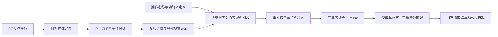

# 分割候选＋判别式 Affordance 估计：IROS 调研与实验计划

调研日期：2026-10-15。本文区分**已发表工作、公开预印本、现有本地实测、拟开展实验**，不把方案设想写成实验结论。

已确认条件：有机械臂和夹爪；允许少量功能标注微调，同时保留零样本结果；当前工程输出为 `grasp / contain / stick / cut / open / shovel / none`，每个候选区域只分配一个类别，最终区域互不重叠。机械臂型号、夹爪形式和控制接口尚未确认，机器人计划按可替换的机械臂＋夹爪＋RGB-D 平台设计。

## 1. 结论与建议

**研究主线：通过部件分割与 System One 区域决策，兼顾功能区域估计的零样本泛化与实时响应。** 部件分割器提供像素边界，复用预训练视觉语言表征的决策模型根据任务和功能定义判断候选，直接输出类别概率，减少自回归文本生成开销。核心待验证主张是：相较任务专用监督模型，对未见物体具有更好的泛化；相较生成式视觉语言模型，在相近功能区域准确率下具有更低的端到端延迟。这是用户明确的研究定位，目前仍是研究假设。

分割候选、编号提示、语言模型选区和功能区域驱动抓取，在 CoPa、MOKA、LLM-Seg、AffordDex 等工作中已有不同形式的实现。因此，论文贡献应由**零样本功能理解、完整系统时延与真实操作效果的联合改善**支撑。仅更换成 Valen 尚不足以证明新颖性；也不预设必须新增训练模块。原始模型的零样本结果作为主线，少量微调作为增强实验单独报告。

| 问题 | 当前判断 | 下一步需要的证据 |
|---|---|---|
| 工程可行吗？ | 可行，已有单图全链路输出 | 多物体、离中心、遮挡场景的完整评测 |
| 能提高准确率吗？ | 有改善空间，尚无 Valen 全集成绩 | 固定候选，只替换判别器，比较 IoU 和错误类型 |
| 一定比 Qwen 快吗？ | 不能确定；当前 Valen 首次判断仍需 9.90 秒 | 常驻、预热、同输入预算的端到端计时 |
| 新颖性够吗？ | 简单组合证据较弱；零样本准确率与端到端时延的联合改善可能形成系统贡献 | 与 CLIP、轻量分类头、简短 VLM 输出及已有部位选区方法比较 |
| 用哪些 benchmark？ | 优先 **UMD＋RAGNet 指定评测集＋自建跨实例/跨类别机器人测试** | 严格沿用公开划分、原生标签与指标 |
| 是否应训练？ | 先验证原始零样本主线；决策头训练与少量 LoRA 作为增强实验 | 零样本与微调分别报告，后者采用相同标注预算与跨物体测试 |

建议论文暂定方向：**基于部件分割与 System One 决策的零样本实时功能区域估计**。英文工作题目可用 *Towards Real-Time Zero-Shot Affordance Grounding via Part Segmentation and System One Decisions*；实时性达标前保留 *Towards*，实验结论按实测描述。`AffordanceJEV` 可作为项目名；论文中明确解释 System One 指复用预训练多模态表征、直接输出决策概率的模型，并标明所用模型来源。

### 1.1 核心主张及验证方式

| 主张 | 必须证明什么 | 必须保留的对照 |
|---|---|---|
| 零样本泛化 | 不使用目标任务标注或示例适配，也能处理冻结测试集中的未见实例/类别；未见功能需另设划分 | 任务专用监督模型、CLIP/SigLIP 区域匹配、原始生成式 VLM |
| 高效功能判断 | 固定候选与输入预算，在接近的 mask IoU 下减少判断延迟；短答案生成也作为对手 | 同一部件候选＋Qwen 简短编号输出，以及参数规模相近的生成模型 |
| 实时系统 | 完整 RGB→定位→部件分割→决策→mask 的 p50/p95 延迟满足预先设定的任务期限 | 全链路同硬件、常驻预热、单请求评测；不能只计算决策头或只报告 batch 吞吐 |
| 机器人收益 | 在动态变化或有响应期限的操作中，提高任务完成率或降低完成时间 | 相同相机、抓取规划器与执行器，固定准确率/时间预算的配对试验 |

“小模型没有零样本能力”不是成立的普遍前提。[CLIP 已展示基于自然语言的零样本迁移](https://proceedings.mlr.press/v139/radford21a.html)，因此轻量开放词表区域匹配是必须比较的基线。模型是否具备零样本能力也不能只由参数量或 System One 名称推出。

实时性先按机器人需要设定预算。例如目标为每秒 10 次完整功能区更新，就应验证完整流程的 p95 是否达到约 100 ms，并同时报告吞吐和实际更新率；这只是预算示例，尚非当前结果。异步跟踪、缓存可以作为后续扩展，但须分别报告语义重判频率、跟踪刷新率和场景变化后的失效恢复时间，不能用视频显示帧率替代语义更新速度。

System One 的共享上下文和决策头属于已有模型能力。我们的可研究环节在于如何把候选部位及功能定义组织成高效、稳定的区域判断，并以消融确认收益来自该设计，而非单纯模型规模、输入分辨率或生成长度不同。优先完成零样本的准确率—时延曲线，再决定是否需要训练或额外机制。

## 2. 我们究竟在解决什么问题

### 2.1 输入、输出与当前工程边界

下图是研究目标流程。当前已跑通 RGB→候选→七类判断→mask 合并；独立拒判、区域特征接入和机器人执行接口属于后续工作。



设图像为 $I$，候选为 $R_1,\ldots,R_K$，功能定义集合为 $D$。判别器计算：

$$
p_{i,c}=f_\theta(I,R_i,D,c),\qquad
\hat y_i=\arg\max_c p_{i,c},\qquad
\hat M_c=\bigcup_{i:\hat y_i=c}R_i.
$$

这里预测的是**区域是否符合某个功能定义**。分割器提供像素边界，判别器提供功能判断，同类区域可以合并。当前 PartGLEE 是开放词表物体/部件分割模型，不保证一次输出穷尽所有真实部位；“全分割”在本文中指生成较全面的候选，不能解释为已经获得完整正确的部位真值。[PartGLEE 官方项目，ECCV 2024](https://provencestar.github.io/PartGLEE-Vision/)

Jev 路线强调结构化决策而非逐 token 文本生成；Valen 提供可本地运行的多模态实现。它们与 JEPA/V-JEPA 不是同一个概念。**不生成文本，仍需进行视觉编码和上下文计算，也仍会分错区域。** 厂商的通用任务速度或置信度声明，不能直接当作本项目的性能。[Jev 官方说明](https://typesafe.ai/blog/introducing-system-one-models-and-jev)、[Valen 官方仓库](https://github.com/Liuziyu77/Valen)

仅在固定七类上测试，能够证明的范围是这些功能下的物体泛化。若要主张开放功能定义，必须在独立研究协议中更换输入定义、保留未训练功能，并检验模型能否按新定义选择；不能只把物体换了就称“未见功能泛化”。

### 2.2 需要分开的三层能力

| 层次 | 要回答的问题 | 对应评价 |
|---|---|---|
| 部位分割 | 候选是否包含正确边界？ | 候选覆盖率、最佳候选/并集 IoU |
| 功能判断 | 给定操作和定义，应该选择哪个部位？ | 最终 mask IoU、区域分类与拒判质量 |
| 物理可执行性 | 机器人能否接触、抓取并完成操作？ | 抓取成功率、任务成功率、完成时间 |

例如，粘毛器的工作滚筒是 `stick` 区域，机械臂通常应抓握柄；识别出刀刃是 `cut` 区域，并不意味着夹爪应抓刀刃。2D mask 也不能单独确定接触力、摩擦、材料性质和完整 6D 操作轨迹。论文首先应明确研究的是**视觉功能区域估计及其对操作的帮助**。

### 2.3 必须先冻结功能定义

当前工程遵循用户要求的单区域单类别。旧 v2 数据允许重叠，药瓶的 `grasp` 和 `contain` 可以指向同一瓶身；因此不能直接用旧的重叠 GT 评价七类互斥预测，并将差异全算成模型错误。

建议分开保留两个协议，不改写原始标签：

| 协议 | 用途 | 输出与标签约定 |
|---|---|---|
| **本地七类互斥协议** | 当前应用、互斥区域研究 | 人工复核后的七类主功能标签；明确类别冲突规则 |
| **公开 benchmark 原生协议** | 与论文公平比较 | 沿用原始类别、查询和重叠规则；必要时使用“给定操作，对候选逐个二分类”的独立评测接口 |

第二种接口是后续研究建议，不代表当前代码已经支持，也不改变当前应用的互斥要求。公开基准若允许一片区域具有多种功能，就不能用互斥七分类的分数冒充原生协议成绩。

还应区分：`none`＝不属于当前功能集合的明确负例；`abstain`＝证据不足，暂不作决定；`background/unassigned`＝背景或没有候选覆盖的像素。当前配置把部分难判断混合区域也放进 `none`，正式研究应单独记录不确定性，避免把拒判统计成“识别正确”。

“禁止整物体”继续作为本地应用要求，但它不一定符合所有公开 GT。公开评测应按原生协议运行；另列施加该约束的受限版本，并报告被约束排除的 GT 比例。不能静默过滤不符合自身规则的测试样本。

## 3. 现有本地证据说明了什么

### 3.1 候选存在，不等于能选对

以下是之前已完成的 50 张 RGB／110 条操作区域实验，数据源见[本地实验汇总](../../docs/大模型路线-实验结果汇总.md)与[逐图记录](../../outputs/part_selection_20261013/index.html)。各模型候选设置不同，比较边界以原记录为准。

| 方案 | 最终平均 mask IoU | 最佳单候选 IoU（GT 离线诊断） |
|---|---:|---:|
| Qwen3.5 通用引导，框点＋SAM2 | 78.20% | — |
| Semantic-SAM＋Qwen 选区 | 43.58% | 83.40% |
| PartGLEE＋Qwen 选区 | 40.82% | 84.78% |
| PartCATSeg＋Qwen 选区 | 9.97% | 17.76% |

这支持“应研究判别环节”的判断，但不能证明 Valen 会填补这个差距。最佳单候选是使用 GT 在预测后选出的诊断值，**不是自动预测结果，也不是多候选并集的绝对上限**。

粘毛器的 10 张图放宽候选阈值后，PartGLEE 平均保留 47.5 个候选，最佳单候选 IoU 为 81.53%；压缩候选数量可能丢掉有用的细部。因此当前“最多 6 个互斥区域”是待验证的工程取舍，不应直接视为论文最优设置。[密集候选记录](../../outputs/part_selection_dense_20261015/README.md)

### 3.2 PartGLEE＋Valen 已跑通，但尚无准确率结论

| 现有单图 smoke test | 实测值或现象 |
|---|---|
| 输入与模型 | 一张 640×480 粘毛器 RGB；原始 PartGLEE＋Valen-4B |
| 候选及输出 | 50 个原始部件候选→6 个互斥区域→七类 mask |
| Valen 输入计算 | 6 道共享上下文选择题，2514 个计算 token，0 个生成 token |
| 首次 Valen `predict` | **9.903 秒**，含图像处理、输入快照和概率转换 |
| PartGLEE 两次模型前向 | 物体 0.506 秒，部件 0.156 秒 |
| 冷启动完整流程 | **41.147 秒**，含模型加载、进程启动、可视化与中间量落盘 |
| Valen 峰值显存 | allocated 9357 MiB，reserved 9556 MiB |
| 观察到的问题 | 握柄、滚筒基本合理；支架出现 stick/contain/open 误判 |

当前缺少线性注意力快速路径依赖，使用 Torch 实现；没有常驻预热基准。不能把上述时延换算成稳定实时帧率，也不能将候选对预测物体的 97.58% 覆盖率写成 IoU。第一次定位误选了边缘物体，后来采用中央主体先验，并在同一图上调试过，因此这张图属于开发验证。

当前还使用固定的五物体／20 部位词表，所有图共享词表，没有逐图输入真实类别。它适用于现有开发范围；在新类别实验中，必须冻结并披露通用词表，增加无部位名称条件的候选对照，不能把针对五物体的设置直接称为任意物体分割。

[分步预览](../../outputs/partglee_valen_smoke_20261015_v2/index.html) · [完整耗时与复核](../../outputs/partglee_valen_smoke_20261015_v2/README.md) · [当前框架](../../partglee_valen/README.md)

### 3.3 现有五物体数据不足以支撑广泛泛化结论

v2 为 5 个实体物体、250 张 RGB，训练 200 张／440 条区域，测试 50 张／110 条区域。每个物体的一次连续采集内随机留出 10 帧；标签经辅助分割与视觉复核，但 `human_verified=false`。这适合调试已见物体的新视角，不能代表未见实例或类别。[数据说明](../../2d_affordance/data/v2/README.md)

这些留出帧已经多次用于比较 prompt 和方案。即使没有进入梯度训练，也已参与研究决策；后续论文应把它们作为**开发集/历史对照集**，另建冻结测试集。不能声称此前数据进入了训练，也不能继续把它们当完全未接触的最终盲测。

## 4. 最接近的工作与新颖性边界

### 4.1 必须正面比较的先行工作

| 工作与发表状态 | 核心关联 | 对本课题的影响／公开情况 |
|---|---|---|
| **CoPa，IROS 2024** | 先标记和选择物体，再细化到部位；部位 mask 约束抓取和后续空间规划 | 与“先物体后部件、再模型选区”高度接近；[论文与项目](https://copa-2024.github.io/)、[源码](https://github.com/HaoxuHuang/copa)公开，GPT-4V 本身为外部模型；会议状态见[作者主页](https://fanqi-lin.github.io/) |
| **MOKA，RSS 2024** | 在 RGB 上标点和网格，将操作转为视觉问答；支持零/少样本 | 编号提示＋问答到机器人动作已有先例；[正式项目](https://moka-manipulation.github.io/)、[源码](https://github.com/moka-manipulation/moka)；使用 GPT-4V |
| **LLM-Seg，CVPR 2024 MMFM Workshop** | SAM 候选＋区域表征＋语言条件选择；支持选择多个 mask | “让语言模型选择已有 mask”以及学习 IoU/区域纯度选择头已有方法；[论文](https://openaccess.thecvf.com/content/CVPR2024W/MMFM/html/Wang_LLM-Seg_Bridging_Image_Segmentation_and_Large_Language_Model_Reasoning_CVPRW_2024_paper.html)、[代码/模型/数据](https://github.com/wangjunchi/LLMSeg)公开；不是 CVPR 主会 |
| **AffordDex，AAAI 2026** | 负功能区域引导灵巧抓取；其中 SAM 候选由 CLIP 相似度定位 | 便宜的判别式区域匹配也已有应用；[论文](https://ojs.aaai.org/index.php/AAAI/article/view/38313)、[源码](https://github.com/Maxwell-Zhao/AffordDex)公开。其完整流程含语言模型先验，不能把整套方法说成完全无生成 |
| **Affordance-R1，AAAI 2026** | GRPO 训练多模态模型推理功能框点，再交给分割器 | 强功能理解基线；[正式论文](https://ojs.aaai.org/index.php/AAAI/article/view/37937)、[官方代码/权重入口](https://github.com/hq-King/Affordance-R1)。本地 SFT/LoRA 是我们的适配版本，不等于复现官方 GRPO 训练 |
| **RAGNet / AffordanceVLM，ICCV 2025** | 大规模指令式功能分割与抓取验证 | 直接对应指令、mask 和机器人，是优先 baseline/benchmark；[论文](https://arxiv.org/abs/2507.23734)、[代码与权重](https://github.com/wudongming97/AffordanceNet) |
| **GLOVER++，CoRL 2025** | 从人类行为数据学习功能区域，服务多种操作任务 | “用功能先验支持泛化操作”已有强对手；[正式论文](https://proceedings.mlr.press/v305/ma25b.html)、[代码/模型入口](https://github.com/TeleeMa/GLOVER)公开 |
| **A4-Agent，官方标注 ECCV 2026 已接收** | 图像想象、功能判断、定位分割分工，零样本推理 | 分离“功能理解”和“精确定位”本身不新；[项目](https://zixinzhang02.github.io/A4-Agent-page/)、[代码与接收公告](https://github.com/EnVision-Research/A4-Agent)；提供本地 Qwen Thinker 路线 |
| **OOAL，CVPR 2024** | 极少样本下对齐视觉特征与功能文本 | 少标注功能泛化已有研究；[论文](https://openaccess.thecvf.com/content/CVPR2024/papers/Li_One-Shot_Open_Affordance_Learning_with_Foundation_Models_CVPR_2024_paper.pdf)、[代码/权重入口](https://github.com/Reagan1311/OOAL)。其 AGD20K 热力图评测另列 |
| **Robo-ABC，ECCV 2024** | 从交互记忆检索并迁移功能接触点 | 示例迁移与跨类别功能推断已有路线；[正式论文](https://www.ecva.net/papers/eccv_2024/papers_ECCV/papers/05748.pdf)、[仓库](https://github.com/TEA-Lab/Robo-ABC)。仓库存在发布 TODO，完整复现能力须单独核对 |

**LLM-Seg 尤其不能忽略。** 它已使用冻结 SAM/DINOv2、语言模型 LoRA 和学习式 mask 选择模块；所以“冻结分割器、训练区域选择头”不能作为首次提出的贡献。我们的区别必须落实到功能定义依赖、实际非生成决策结构、候选粒度变化下的鲁棒性及机器人效果。[LLM-Seg 方法全文](https://arxiv.org/html/2404.08767v1)

### 4.2 组件与近期补充

| 工作 | 本项目中的角色与使用边界 |
|---|---|
| [PartGLEE，ECCV 2024](https://provencestar.github.io/PartGLEE-Vision/) | 当前主候选器；应与不依赖部位词表的 SAM2 自动候选比较 |
| [Semantic-SAM，ECCV 2024](https://github.com/UX-Decoder/Semantic-SAM) | 多粒度候选对照；不能只比较默认候选数量不同的两组 |
| [SAM 2](https://github.com/facebookresearch/sam2) | 自动候选与框点分割的通用对照；权重版本和运行模式分别记录 |
| [SoM](https://github.com/microsoft/SoM) | 编号区域提示的直接先例；公开预印本/工具，不把它写成新的编号机制 |
| [Valen](https://github.com/Liuziyu77/Valen) | 开源决策模型及训练工具；本次未核实同行评审论文，不能把项目发布等同论文发表 |
| [AffordGrasp](https://eqcy.github.io/affordgrasp/) | 语言推断目标部位后进行任务抓取，相关性高；项目页的 Code 未提供可用链接，本次不列为已核验开源复现基线 |
| [AffordanceLLM，CVPR 2024 Workshop](https://openaccess.thecvf.com/content/CVPR2024W/OpenSUN3D/html/Qian_AffordanceLLM_Grounding_Affordance_from_Vision_Language_Models_CVPRW_2024_paper.html) | 功能理解相关工作；[仓库](https://github.com/JasonQSY/AffordanceLLM)主要公开数据处理，不假定包含完整训练和权重 |
| [AffordanceSAM，2025 预印本](https://arxiv.org/abs/2504.15650) | 通过训练适配 SAM 做功能定位；不应误列为纯零样本 SAM 使用方法，代码/发表状态待进一步核验 |
| [SpatialAfford，2026-08 预印本](https://arxiv.org/abs/2608.00502) | 监督视觉注意与空间定位，关注紧凑模型的功能部位理解；提醒我们“小模型＋视觉对齐”也不是空白。本次未核实可复现代码/权重 |

上述检索没有构成“此前无人做过”的证明。投稿前应按最终方法重新检索，并重点追踪区域判别、少样本功能理解和紧凑视觉语言模型的更新。

### 4.3 新颖性如何估计

以下是基于上述文献的研究判断，不是录用概率。

| 拟贡献 | 新颖性判断 | 应如何处理 |
|---|---|---|
| PartGLEE＋编号图＋Valen＋mask 并集 | 弱，主要是系统组合 | 作为基础实现和零样本 baseline |
| 改阈值、减少候选、量化、模型常驻 | 常规工程优化 | 作为效率实验，不单独包装成算法贡献 |
| 少量七分类 SFT | 单独看仍弱 | 必须与 CLIP、线性头、MLP 和同预算 VLM SFT 比较 |
| 学习“局部证据＋功能定义”的条件决策，抵抗部位名称和类别先验 | 有研究价值 | 用定义替换、同图不同任务、未见实例/类别测试证明 |
| 对候选碎片化/合并变化保持稳定，在时延预算内决定是否细分 | 有潜力，但设计与效果待验证 | 与固定候选数、固定阈值、LLM-Seg 式选择头消融 |
| 在同一动作执行器下改善任务成功率和响应时间 | 对 IROS 很有价值 | 需要真实机器人对照，不能只展示成功视频 |

推荐控制范围：**主线是部件候选与 System One 决策实现的零样本功能区域估计，以及准确率—时延改进对真实操作的价值。** 定义条件下的区域表示、候选组织与共享计算可作为待验证的方法设计；少量训练是可选增强，不替代零样本主结果。概率校准、候选整理、缓存作为支撑实验，不必同时宣称多个新模块，也不把 Valen 已有的决策结构作为本项目提出的算法。

## 5. Benchmark 的选择与协议

### 5.1 推荐组合与优先级

| 数据集 | 已核实内容 | 建议角色 | 注意事项 |
|---|---|---|---|
| **UMD RGB-D Part Affordance** | 105 个工具、17 个工具组、7 种功能，另有 3 个杂乱场景；像素标签与多功能排序 | **第一优先**：部位级 mask、未见实例/类别、少样本训练 | 使用原生 split 和有效标注帧；RGB-only 主实验中深度不进感知模型 |
| **RAGNet** | 273k 图像、180 类、26k 推理指令，提供多个约 1k 图的评测子集 | **第二优先**：指令式功能定位及域外泛化 | 先评测指定子集，无需为了测试下载/训练全部 273k 数据 |
| **自建新物体测试** | 尚未采集；当前五物体仅作开发 | **必需的机器人证据**：功能定义、视角/距离、未见物体 | 人工确认标签、实体与会话隔离，冻结后不调 prompt |
| **ReasonAff** | Affordance-R1 配套推理式功能数据；提供官方获取入口 | **补充优先**：衔接已有 R1 基线 | 原始标签较粗、清洗版状态及访问条件需核对 |
| **IIT-AFF** | 8,835 图、10 物类、9 功能、24,677 功能部位 | **扩展验证**：更复杂图像中的物体与功能分割 | 保留原生 9 类；与 2018 AffordanceNet 等传统方法联系 |
| **AGD20K** | 20,061 外视角图、3,755 自我视角图、36 功能 | **可选附录**：与 OOAL 热力图路线比较 | 使用 KLD/SIM/NSS，不能把阈值化 mask IoU 冒充官方结果 |

来源：[UMD 官方页面](https://users.umiacs.umd.edu/~fermulcm/affordance/part-affordance-dataset/index.html)、[UMD README](https://users.umiacs.umd.edu/~fermulcm/affordance/part-affordance-dataset/README.txt)、[RAGNet 数据说明](https://github.com/wudongming97/AffordanceNet/blob/master/docs/dataset.md)、[ReasonAff 官方入口](https://github.com/hq-King/Affordance-R1)、[IIT-AFF 官方页面](https://sites.google.com/site/iitaffdataset/)、[AGD20K 原论文，CVPR 2022](https://openaccess.thecvf.com/content/CVPR2022/papers/Luo_Learning_Affordance_Grounding_From_Exocentric_Images_CVPR_2022_paper.pdf)。

**最小可投稿实验组合不必覆盖所有表格：UMD＋RAGNet 的未见类别/推理子集＋新物体真实操作，优先做完整。** 若 RAGNet 数据接入受阻，可用 IIT-AFF 增强感知验证，但仍需保留一个指令/定义变化评测，不能只留下固定标签分割。

### 5.2 UMD 的关键细节

官方定义为 `grasp / cut / scoop / contain / pound / support / wrap-grasp`。`*_label.mat` 保存主要功能标签，`*_label_rank.mat` 保存七功能的排序，背景为 0。README 明确说明：每三帧中有一帧提供真实标注，其余自动生成标签未用于原作者训练和测试。本次接入已核实原始 .mat 自带 `gt_type=manual/automatic`，代码直接按该字段筛选，不猜测帧号，也不把所有存在标签的帧视为人工 GT。详见 [UMD 测试说明](UMD测试说明.md)。[UMD 官方格式与划分说明](https://users.umiacs.umd.edu/~fermulcm/affordance/part-affordance-dataset/README.txt)

建议分别报告原生实例划分和 `novel_split.txt`，按实体工具隔离训练与验证；交叉验证使用官方 fold 文件。主结果只用可信标注帧，自动传播帧若用于训练增强，应作为独立消融。当前 `AffordanceJEV/data` 中已出现 UMD tools 压缩包，但本次检查时文件仍在增长，**没有认定其下载完整或已通过解压校验**。

同时保留两套有名字的评测配置：原生功能分割协议，以及 Affordance-R1 等工作的指令式 UMD 评测协议。必须核对后者实际用了哪些图、类别、查询和 ROI；不因都叫 UMD 就直接与论文表格比数值。

| 本地类别 | 与 UMD 的关系 | 处理方法 |
|---|---|---|
| grasp | 不能同时吞并 grasp 与 wrap-grasp | 公开评测保留两类区别 |
| contain、cut | 名称相近 | 仍核对容器外表面/腔体、刀片/刃的标注定义 |
| shovel | 不是 UMD 原生功能名 | 不统一替换成 scoop 或 support，按原标签分别评价 |
| stick、open | UMD 七类未覆盖 | 在自建数据或其他合适 benchmark 中验证 |
| none | 不等于 UMD 背景 | 分别记录物体无匹配区域、未知与场景背景 |

### 5.3 RAGNet 与 ReasonAff 的实际选择

RAGNet 先固定四个入口：`graspnet_test_novel_val.pkl`、`3doi_val.pkl`、`handal_easy_reasoning_val.pkl`、`handal_hard_reasoning_val.pkl`。需要域内对照时再加 GraspNet seen。官方表列这些评测设置各约 1k 图，但指令数量、重复 RGB 数与实际下载版本仍要由清单统计。easy/hard 可能复用 RGB，不能算成独立图像扩充。采用官方评测器中的 gIoU/cIoU 定义，固定版本。[官方数据清单](https://github.com/wudongming97/AffordanceNet/blob/master/docs/dataset.md)、[论文评测划分](https://arxiv.org/html/2507.23734v1#S3.SS4)

RAGNet 部分标签使用 SAM2 等辅助构建；这使独立人工标注的真实场景测试更重要。只使用其官方测试文件不意味着所有基础模型均未见过这些图像，必须披露上游预训练数据不可完全核验的边界。[数据构建说明](https://github.com/wudongming97/AffordanceNet/blob/master/docs/dataset.md)

ReasonAff 官方仓库仍提示原始测试 GT 存在粗标注、拟提供清洗版本；本次访问其 Hugging Face 页面需要接受访问条件。实施时应记录实际获得的版本、清单与哈希；如果自建复核子集，必须预先公布规则，并与原版成绩分列，不能只删掉模型失败的样本。[官方说明](https://github.com/hq-King/Affordance-R1#dataset)、[数据访问页](https://huggingface.co/datasets/hqking/affordance-R1)

## 6. 建议的方法与少量训练方案

本节是拟实施方案，不是已完成的算法或结果。

### 6.1 先建立可解释的最小版本

1. **候选器冻结。** 在训练/验证数据上确定通用候选词表、前景策略、候选数范围。推理不读取物体真值类别、功能 mask 或 GT 框。
2. **一次图像编码，多区域判断。** 原始 Valen 共享 state 作为基线；先比较原图＋编号图与逐区域高亮图的必要性，避免重复图像占用大量视觉 token。
3. **区域与定义显式对应。** 每题仅判断当前区域；输入包括局部证据、整体物体上下文、操作名称和可编辑功能定义。
4. **结构化输出。** 输出类别概率、最终 ID 和不确定状态；同类并集，保留每步信息。单类别规则由明确协议决定。

多物体场景不能继续只选择中央物体：应枚举预测实例及其部件，用原始任务在全场景上下文中筛选，或接入统一的任务条件目标定位器。原任务明确给出的对象名称可正常使用，但不能额外喂入测试 GT 类别。两种定位策略单列成本，离中心和干扰物场景必须进入评测。

当前编号图只是视觉提示，不能保证模型准确绑定像素与区域 ID。研究版可增加由 mask 池化得到的局部特征，并结合全局上下文与定义特征做选择。**该改动需要实现并训练接入层，不是给 Valen 的现有 API 多传一个张量即可。** PartGLEE 的特征也不能无适配地替代 Valen 的视觉 token。

### 6.2 保留四条清楚的实验线

| 编号 | 使用标签/示例 | 参数更新 | 可以怎样表述 |
|---|---|---|---|
| Z0 | 仅通用操作定义，没有目标数据示例 | 无 | 目标数据零样本基线；阈值/定义不能用目标测试标签挑选 |
| Z2 | 每操作 2 条固定训练示例 | 无 | 少样本上下文学习，不能再称零样本 |
| F1 | 少量训练区域标签 | 先更新决策头，冻结视觉/语言主干 | 少样本监督区域分类 |
| F2 | 与 F1 相同 RGB/标签预算 | 决策头＋小规模 LoRA；视觉 merger 是否训练另做消融 | 少样本适配后的区域判别 |

严格 Z0 不用目标训练/验证标签选择定义和阈值，可先直接 argmax（含 none）。若用目标验证标签进行概率校准或挑选拒判阈值，应单列“Z0＋校准”，披露这部分监督；它不再是完全没有目标数据监督的版本。

Valen 已公开 SFT 和训练入口，4B 模型说明包含决策头预热及联合 LoRA 训练；可作为训练适配的起点。**本地合并后的 HF 推理权重如何初始化到官方训练 checkpoint 格式，仍需做加载、前向一致性与梯度检查，不能假定直接续训兼容。** 不应在未知兼容性下重建头并误称“从现有 Valen 继续微调”。环境继续使用 Conda。[Valen 本地模型说明](../../Valen-4B/README.md)、[官方训练工具说明](https://github.com/Liuziyu77/Valen/blob/main/scripts/README.md)

优先 SFT 的理由是监督目标清楚、成本和消融更容易控制；不是声称 SFT 必然优于 RL。RLCD/GRPO 放到后续扩展，第一版不同时引入强化学习和新的机器人策略学习。

### 6.3 训练样本应迫使模型关注定义与区域

**样本单位：**一张训练 RGB＋它在冻结候选器下的候选集合＋定义集合＋各区域标签；不能只用漂亮的 GT 裁剪训练、测试却输入错误候选。

重点加入四种有真实标签依据的样本：

| 训练因素 | 具体做法 | 要消除的捷径 |
|---|---|---|
| 同物体相邻部位 | 握柄/支架、盖/瓶身、工作头/连接件成组出现 | 仅识别出物体名称就选择区域 |
| 同图不同任务/定义 | 同一图分别查询工作接触面、握持区、开启部位 | 不读任务，只输出固定常识 |
| 编号与选项重排 | 保持像素不变，打乱区域 ID、显示颜色与选项顺序 | 记住编号、颜色或固定答案位置 |
| 候选缺陷 | 保留跨边界、碎片化、漏目标的真实候选；单独标 mixed/uncertain | 对任何候选都强行自信分类 |

定义变化应具有合理语义，例如“专用握柄”与“允许稳定握持的非工作表面”，由人工分别确认目标 mask。不能只替换定义文字，却沿用原答案。类别名改成 A/B/C、保留完整定义，可作为**是否真的读定义**的测试；它不是普通开放词表性能的替代。

训练 ICL 时，支持示例和查询图全部来自训练实体池，优先使用不同实体、不同会话，并保留无示例 episode。测试的新物体若提供支持图，需单独命名为“新物体少样本适应”，与没有支持图的未见物体零样本分开。

### 6.4 损失与监督：先简单，再证明额外模块有用

第一版只使用区域交叉熵。对于高纯度候选分配类别；混合候选的阈值在验证集确定，不能一律当 `none`。可在第二版增加：

$$
\mathcal L=\mathcal L_{cls}
+\lambda_d\mathcal L_{definition}
+\lambda_s\mathcal L_{stability}.
$$

- `L_definition`：正确区域与正确定义的匹配，应优于同图中语义接近的错误定义；使用人工确认的成对样本。
- `L_stability`：对编号重排、同义定义和相同语义区域的合理碎片化，映射回原图后的决策应一致。不同任务或真正改变含义的定义，不施加一致性。

这是拟设计的消融方向，并非现成独创性证明。IoU/区域纯度回归、对比学习、温度校准本身都是已有工具，不能仅换到 affordance 就宣称新损失。只有在必要性和泛化收益被实验支持后，才纳入最终方法。

### 6.5 候选规模与拒判

先测试 `K=4/6/12/24/50`，不要把 6 写死成科学结论。研究内部可以保留候选层级，但交给用户的最终输出仍为互斥区域。比较“先硬分配重叠像素再分类”和“保留层级判断、最后分配像素”的差异；二者必须分别计算候选能力上限。

若置信度低、区域明显混合或没有合适候选，输出拒判；可选的二次细分应计入延迟，并与固定多候选方案比较。只有在验证集上校准过的概率，才适合讨论某阈值对应的经验错误率；仍不能保证分布外可靠性。阈值拒判与 `none` 分开统计，防止靠拒绝困难样本提高表面准确率。

## 7. Baseline：哪些必须跑，怎样才公平

### 7.1 固定候选，专门比较判断能力

这张表的所有方法读取**相同的预测物体、候选 mask、定义与 RGB**，复用候选缓存；GT 只在预测后评分。该表最能回答换判别器是否有效。

| 优先级 | 基线 | 为什么不能省略 |
|---|---|---|
| 必须 | 随机、最大面积、PartGLEE 最高质量候选 | 检查是否只是面积/质量偏好在起作用 |
| 必须 | CLIP 或 SigLIP 区域图文相似度，零样本 | 判别式语义匹配本来就可能很快；使用功能定义文本，固定阈值协议 |
| 必须 | 冻结 DINO/SAM 区域特征＋线性头/小 MLP | 排除固定七类只是普通小分类器即可解决；与微调版本使用相同标注量 |
| 必须 | 训练示例的区域特征原型匹配 | 少样本参考是否需要大模型上下文；避免只与弱零样本比较 |
| 必须 | Qwen3.5-9B 简短 ID 输出，无 thinking | 不能用长 CoT 的生成耗时作为唯一速度对手 |
| 必须 | Qwen 同规模骨干的受限选择／候选答案打分 | 分离“参数量不同”和“取消逐 token 生成”的影响，记录完整选项评分成本 |
| 必须 | Valen-4B 原始 Z0、少样本 Z2、F1、F2 | 回答预训练能力、ICL 与本地适配各贡献多少 |
| 第二阶段 | Valen-0.8B、2B、4B | 测量精度—延迟—显存曲线，不假设 4B 一定最适合部署 |
| 第二阶段 | LLM-Seg 官方方法或其选择模块适配版 | 最接近学习式 mask 选择；适配版必须明确写明改动，不能冒充原论文复现 |

其中 CLIP/SigLIP、线性头、原型等为本研究统一候选下实现的基线，不是 AffordDex/OOAL 整套系统的直接复现。DINO 特征本身不与文本天然对齐；“DINO＋固定分类头”只评价固定类别，开放定义测试需要额外文本对齐，并单独说明训练量。

### 7.2 完整端到端方案比较

| 方法 | 角色 | 备注 |
|---|---|---|
| Qwen3.5-9B 原始通用引导＋SAM2 | 现有直接框点基线 | 复用已冻结提示，统一解码和输入预算 |
| 官方 Affordance-R1＋SAM2 | 已发表功能推理基线 | 原始权重；与“本地 SFT/LoRA”分两行 |
| Qwen3.5／Affordance-R1 本地 SFT/LoRA | 标注预算对照 | 在新划分上重新训练/评测，不能搬用旧五物体成绩 |
| RAGNet 的 AffordanceVLM | 近期分割与机器人基线 | 使用官方权重，记录其额外训练数据 |
| Mask2Former／传统 AffordanceNet | 固定类别的直接像素分类对照 | 检查通用大模型路线相比专用分割是否值得；与新定义测试分开 |
| GLOVER++ | 强监督功能泛化对照 | 第二阶段加入，按官方输入协议提供信息 |
| CoPa 式局部化选区 | 最接近机器人管线对照 | 原版 API 与本地 Qwen 改写版分开命名 |
| A4-Agent 本地路线 | 近期零样本复杂管线 | 算力允许再做；必须计入 Dreamer/Spotter 等组件成本 |
| PartGLEE＋Valen | 我们的基础版与研究版 | 分别报告原始零样本和少量微调结果 |

API 方法的网络、费用和模型版本单列；本地延迟主表优先用本地权重。官方模型已经过其他数据训练时，只能称“对目标数据零样本”，不能与从未学过 affordance 的模型混称为同等监督。

传统模型可参考已发布 UMD 权重和评测工具的 [aff-seg（ECCV 2024 ACVR Workshop）](https://github.com/apicis/aff-seg)；其中的 Mask2Former 为功能分割适配版。2018 年的 [AffordanceNet](https://github.com/nqanh/affordance-net) 与 RAGNet 项目中同名的 2025 框架不是同一方法。区域图文匹配可采用 [SigLIP 2](https://arxiv.org/abs/2502.14786) 作为现代编码器对照，固定具体 checkpoint 后再测速度。

### 7.3 统一比较条件

- 两层计时：**选择器耗时**固定候选；**端到端耗时**含物体定位、候选生成、图像处理、判别、合并。不能将不同口径互相比较。
- 同一 GPU、相同并发状态、固定精度与图像尺寸；所有运行记录峰值 allocated/reserved 显存。多卡与 API 结果另列。
- 同一操作查询时比较单次 RGB＋操作；多操作批量输出时比较一张 RGB 的完整功能图，不把七类总时间除以七伪装成单请求延迟。
- 微调方法按独立 RGB、实体物体和标注像素预算对齐，同时列区域题目数；一张图派生几十道题不等于几十张独立训练图。
- 候选框、目标物体类别、前景 mask 若来自 GT，只能进入 oracle 对照，不能进入主结果。
- 失败、空候选、超时和不合法输出全部记录；按固定协议评分，不删除失败样本。

## 8. 候选能力、准确率与速度怎么测

### 8.1 先确定损失发生在哪一层

给定 GT 区域 $G$，在生成和选择全部结束后，离线计算：

$$
U_{single}=\max_i\operatorname{IoU}(R_i,G),\qquad
U_{union}=\max_{S\subseteq\{1,\ldots,K\}}
\operatorname{IoU}\left(\bigcup_{i\in S}R_i,G\right).
$$

| 诊断 | 含义 | 不能如何解释 |
|---|---|---|
| 预测物体前景对 GT 的召回率 | 目标定位是否先裁掉了真正功能区 | 前景面积大不代表定位/功能正确 |
| 原始候选最佳单 mask | 是否有一个已足够完整的候选 | 不是多区域合并上限 |
| 互斥化后的最佳并集 | 当前最终区域表示最多能达到什么程度 | 不是实际模型成绩 |
| 并集 oracle 减最终 IoU | 当前表示下，选择与约束导致的损失 | 不能全部归因于视觉编码器 |
| GT 物体 ROI 与预测 ROI 对照 | 物体定位误差的影响 | GT ROI 结果不能放主性能行 |

当前 6 个区域只需枚举 64 个并集即可求精确 oracle。对非空 GT，互斥候选数较大时，令 $t_i=|R_i\cap G|$、$f_i=|R_i\setminus G|$，并集 IoU 为 $\sum t_i/(|G|+\sum f_i)$；按 $t_i/f_i$ 降序检查前缀可求最优，零假阳性的非空真阳性区域先纳入。重叠候选不满足这个加法形式，近似搜索结果须标“搜索得到的并集成绩”，不能当严格上限。

上述并集 oracle 对每个操作独立求解，尚未加入“禁止整物体”和跨类别互斥竞争，因此是放宽约束的上限；另计算加入应用约束后的可达成绩。不能假定所有类别都能同时达到各自的独立最优值。

**执行顺序：先跑这套诊断，再决定是否训练。** 如果正确区域已在互斥化/候选压缩阶段丢失，提高判别器能力也无法恢复它。

### 8.2 主指标保持少而明确

| 维度 | 主指标 | 补充诊断 |
|---|---|---|
| mask | 逐查询平均 IoU、累计 IoU；同时按功能/实体宏平均 | P@50、细小区域边界、误选整物体率 |
| 区域分类 | macro-F1、混淆矩阵 | 把支架误判为工作区、把盖误判为握持区的比例 |
| 置信度 | NLL/Brier；拒判覆盖率—错误率曲线 | ECE 仅作补充，记录分箱与样本数 |
| 运行成本 | 常驻端到端 p50/p95 秒、峰值显存 | 选择器、候选器、预处理、合并各阶段耗时；冷启动另列 |
| 机器人 | 任务成功率、功能正确的抓取成功率、任务完成时间 | 定位/选择/几何/控制失败分别统计 |

本研究的平均 IoU 定义为逐 RGB×操作计算再平均，累计 IoU 为所有交并像素总和之比；公开 benchmark 使用其官方实现，并说明二者是否一致。IoU、P@50 和真实机器人成功率是不同量，不互相改名。

与传统 UMD/IIT-AFF 分割论文比较时，补报其使用的 weighted F-measure，并固定公式、参数和划分。它与 IoU 不可直接换算；本研究的 IoU 表不能替代全部原生指标。[采用该指标的近期原论文及 UMD/IIT-AFF 实验](https://link.springer.com/article/10.1007/s44443-026-01148-w)
无目标查询单列拒识准确率/误报率。自建协议中，GT 非空而输出空计 IoU=0；GT 为空且输出为空的情况单独统计，不混入正样本平均 IoU 人为抬高成绩。公开协议按其原定义处理。

置信区间按实体/场景分组 bootstrap；微调至少 3 个随机种子。相邻视频帧高度相关，不能将一千帧当一千次独立泛化试验。机器人报告分子/分母、区间及配对场景差异，小样本不宣称统计显著。

### 8.3 速度验证的具体做法

1. 固定一个未参与性能筛选的计时图集，覆盖 6/12/24 个区域及不同物体大小。
2. 模型常驻，先预热，再测不少于 100 次有效请求；单并发 batch=1 作为在线主指标。显式 CUDA 同步，单列磁盘读取与可视化写盘。
3. 首先测现有实现，然后逐项测试快速注意力路径、视觉 token 预算、共享 state、减少重复高亮图和模型尺寸；每项都复查预测变化。
4. 分别保存首次调用、常驻模型计算、完整本地服务、相机网络传输时延。展示“平均 0.x 秒”时必须对应明确的测量范围。
5. 若优化后仍明显慢于 CLIP/MLP，检查定义推断带来的准确率或泛化收益是否值得这笔成本；没有收益就不应坚持用 4B 模型。

短期工程目标可设为**同等准确率附近，端到端至少快于简短 Qwen 基线 2 倍，或在固定时限下显著提高任务成功率**。这是继续投入的决策目标，不是已有结果或 IROS 的硬性要求。初步争取 1–2 秒级更新；没有实测前不写“实时 30 FPS”。

## 9. 数据与实验设计

### 9.1 新数据的建议规模

比继续密集拍摄同一个物体更有价值的是增加实体、类别与采集会话。下面给出可缩放的起点，数字是采集建议。

| 集合 | 示例划分 | RGB 数量示例 |
|---|---|---:|
| 训练 | 6 个已见类别，每类 2 个实体 | 12×24＝288 |
| 验证 | 同 6 类，每类另 1 个实体 | 6×24＝144 |
| 未见实例测试 | 同 6 类，每类另 1 个实体 | 6×24＝144 |
| 未见类别测试 | 另 4 类，每类 4 个实体 | 16×24＝384 |
| **总计** | **10 类、40 个实体；每实体 3 会话×8 个取景** | **960** |

每个取景覆盖视角、距离/目标像素大小、照明、背景与遮挡；不要以相邻连续帧代替独立取景。训练/验证/测试实体完全隔离。若只验证未见类别但已见功能，应在选类别时确保训练数据覆盖相同功能；未见功能另开 leave-one-action-out 实验，不能混淆。

在训练池内做每实体 `1/5/10/20` 张 RGB 的标注预算曲线，3 个种子，所有方法复用同一名单。公开数据的训练预算也按实体与 RGB 单独记录。不承诺 960 张足以达到某个 IoU，先从小规模试验估计曲线。

### 9.2 标注与冻结

标注对象包括物体实例、原生功能 mask、七类互斥派生标签、可见性和不确定区域。保留原始 RGB、相机内参、对齐深度与采集会话 ID；深度只用于机器人几何的主方案需明确标为“RGB 感知＋RGB-D 执行”。

测试 mask 由人工确认。建议双人独立复核至少 20% 和所有争议区域，报告分歧与裁决规则；不能把 SAM/模型生成后仅自动复核的标签写成独立人工 GT。support/query、同一实体多视角、原图与增强图必须作为一个划分组。

在首次测试前冻结 `split_manifest`、标签版本、候选参数、定义文本、校准阈值与模型版本。之后新增定义或改阈值进入新的开发轮次；最终结论使用尚未参与这些选择的留出对象/场景。

### 9.3 最有辨识度的消融实验

| 实验 | 固定什么 | 改什么 | 回答的问题 |
|---|---|---|---|
| 判断器对照 | 候选与 RGB | CLIP/MLP/Qwen/Valen | 大模型判别是否有独立价值？ |
| 定义对照 | 同图同候选 | 类别名、完整定义、合理的新定义 | 模型是否真的服从定义？ |
| 编号稳定性 | 像素与定义 | ID、颜色、选项顺序 | 是否存在提示格式捷径？ |
| 候选粒度 | 判断器 | 6/12/24/50，互斥化顺序 | 精度与效率的瓶颈在哪里？ |
| 图像证据 | 同一训练预算 | 编号图、局部高亮、mask 区域特征 | 局部证据绑定是否必要？ |
| 小样本学习 | 固定样本名单 | 无训练、原型、ICL、头训练、LoRA | 收益来自示例还是参数更新？ |
| 目标定位 | 固定部件/判别步骤 | 预测物体、GT 物体、离中心杂乱场景 | 前景选择是否依赖取景先验？ |
| 缺失/不确定 | 固定测试子集 | 不拒判、阈值拒判、有限二次细分 | 拒判能否降低操作失败且保持覆盖？ |

主论文挑选支持最终贡献的 4–5 项，其他放附录；不是要求第一天把整个组合网格全部跑完。

## 10. 真实机械臂实验

### 10.1 先固定动作执行器

感知方案输出功能 mask；所有比较方法共用目标选择协议、深度重建、抓取候选生成、运动规划和固定动作原语。避免我们的模型额外使用人工修正、其他方法只用直接输出。

从 mask 到三维时，应使用正确的相机坐标模型与外参。现有 RealSense 数据保留了对齐深度的几何说明，不能只凭“像素已对齐”便假定所有深度值都是 RGB 相机坐标系的 Z；需要核对原始深度反投影、外参变换和手眼标定。无效深度/不可达接触点的处理规则对所有方法相同。

可选使用公开 GraspNet 候选，再以握持区域约束；CoPa 已公开这一类连接方式。其作用是固定执行接口，不把现成抓取器算作我们的创新。[CoPa 抓取模块](https://copa-2024.github.io/)、[GraspNet](https://github.com/graspnet/graspnet-baseline)

### 10.2 优先任务

| 任务 | 需要的功能理解 | 建议成功标准（实验前冻结） |
|---|---|---|
| 握持工具并摆放/递交 | 抓握持区，避开工作接触面 | 从指定功能部位抓取，抬起并保持 3 秒，放到目标区，无掉落 |
| 粘毛器清洁 | `grasp` 与 `stick` 的分工 | 从握柄抓取，滚筒接触指定表面，完成固定行程；独立测量清除比例 |
| 铲取并转移物料 | `grasp` 与 `shovel` 的分工 | 固定路线后进入目标容器的物料比例达到预设阈值 |
| 可选：开启易操作盖/翻盖 | 区分盖、主体与连接部位 | 开启至预设状态，不将“碰到盖”当成功 |

药瓶应先用于盖/瓶身识别和任务相关抓取验证。单机械臂、单夹爪若没有固定瓶身的夹具，不应默认能可靠完成拧盖；该动作会引入与视觉研究无关的主要控制瓶颈。`contain` 可以用于容器选择/放入位置，但完整倾倒能力也需额外姿态和控制。

### 10.3 数量与公平性

建议先用非测试物体做 20 次工程试运行。正式选择 3 类任务，每类 4 个未参与训练的实体组合，每组合 10 种预先保存的姿态/干扰配置：**每方法 120 次任务**。主比较先取 3 个方法，共 360 次；强基线可依据开发集确定为 Qwen 框点或 AffordanceVLM，另加原始 Valen 和研究版。

这是起始规模，不是统计功效保证。按预实验方差和配对差异决定是否增加对象。各方法场景配对，随机执行顺序，保留失败视频、超时和人工介入；同时报告抓取成功与任务成功。拒判计入总体未完成，同时单列拒判后的执行成功率，避免靠少做任务提高成功率。

速度贡献应体现在：从取图到可用动作的时间、固定总时间内完成任务的比例，以及物体轻微移动后重新定位的恢复能力。静态任务若慢方法最终也能成功，可主张缩短等待；不能自动推导出更高操作成功率。

## 11. 推进顺序、资源与停止条件

### 11.1 建议按 10 周排程

| 阶段 | 工作 | 明确交付与决策 |
|---|---|---|
| 第 1 周 | 核验 UMD、冻结标签协议；量化原始/互斥候选 oracle；建立常驻计时 | 确定瓶颈是目标定位、候选边界还是选区；完成 Z0 最小基线 |
| 第 2 周 | 固定候选对比 CLIP、MLP、简短 Qwen、Valen；建立新物体标注规范 | 若 Valen 无准确率/定义优势且更慢，优先换轻量判别器 |
| 第 3–4 周 | 小样本头训练、LoRA；定义/编号/候选缺陷训练；采集新物体 | 学习曲线、实体隔离验证、3 个种子，冻结研究版 |
| 第 5–6 周 | UMD、RAGNet、跨类别与定义变化正式评测 | 完整主表、候选诊断、效率曲线；失败样本全部保留 |
| 第 7–8 周 | 固定执行器下真实机械臂对照 | 成功率、延迟、功能正确性、失败归因和原始视频 |
| 第 9 周 | 有针对性的必要消融与稳健性验证 | 判断每个模块是否值得保留，避免只挑有利结果 |
| 第 10 周 | 论文与复现材料 | 总表、方法图、置信区间、代码/权重/划分说明 |

排程是工作量建议，未确认投稿届次与截止日期，不写未经核实的 IROS 日程。机器人验证和公开基准增强说服力属于本调研判断，不是声称 IROS 官方规定必须做多少次实验。

### 11.2 计算资源的现实安排

当前单张 RTX 4090 已能进行 PartGLEE 与 Valen-4B 分阶段推理；Valen 实测峰值约 9.14 GiB allocated。但两个模型同时常驻的总显存、4B LoRA 训练激活与优化器内存尚未测量，不能用推理显存直接推算训练显存。

先以 1 张 24 GB GPU 验证短输入、微批次 1、冻结主干的头训练；LoRA 是否单卡可行由实际 token 数和梯度检查点决定，必要时使用多卡分片。普通数据并行会在每卡复制模型，并不会让单份模型显存减半。训练与计时分开安排，避免共享 GPU 负载污染速度结论。所有环境继续放 Conda，配置文件只保存环境名称和版本。

候选器冻结后可以缓存 mask；只训练头且表示不随训练变化时才缓存特征。LoRA/视觉 merger 变化后，不能继续用旧特征当新模型输出。缓存容量按实际样本和表示测量，不预先虚报 GPU 小时。

### 11.3 建议的继续/转向标准

这些是资源决策门槛，**不是达成结果，也不是必须跨过的学术评分线**。

- **候选门槛：**开发集并集 oracle 若只比强端到端基线高不到约 3–5 个百分点，选择器的可提升空间有限；优先修改候选表示或缩小任务范围。不能只用最好的一张图支持训练。
- **功能学习门槛：**研究版至少应在新实体/新定义中优于同预算小 MLP/原型，且改进置信区间与错误分析一致。只在五个已见实体涨分，不支持通用功能判断主张。
- **效率门槛：**与简短输出 VLM 在相近准确率下得到明显端到端优势；若只有少输出 token、整体仍慢，就改论文主张或改模型。
- **机器人门槛：**感知收益能够体现在功能正确的接触、任务成功或任务时间；若主要失败全来自控制，先稳定执行器，再增加感知算法。

## 12. 论文应呈现的证据与复现产物

正文建议用六个图表讲清楚研究：

1. **方法图：**像素候选、区域证据与功能定义如何进入判别器，何处共享计算。
2. **公开基准总表：**监督量、原生协议、IoU 与端到端 p50/p95；Z0 和少样本模型分组。
3. **少样本泛化曲线：**按独立训练 RGB 数，分别展示新实例、新类别和定义变化。
4. **候选与选择误差图：**原始候选 oracle、互斥并集 oracle、最终预测，明确改善来自哪一环。
5. **精度—延迟图：**CLIP/MLP、简短 Qwen、Valen 不同尺寸及研究版，在同硬件同口径下比较。
6. **机器人表与失败图：**配对任务成功、时间、拒判和失败原因；含粘毛器/药瓶等难例，不只展示成功样本。

后续运行建议保存以下最小产物；本次调研不创建虚假的实验结果：

```text
AffordanceJEV/
├── docs/                 # 本调研、冻结评测协议、实验记录
├── configs/              # 定义、候选、模型与训练/评测参数
├── data/UMD/manifests/   # UMD 实体划分、标签版本、文件哈希
└── outputs/<experiment>/
    ├── protocol.json    # 模型 revision、依赖、监督量、阈值与计时范围
    ├── predictions.jsonl
    ├── metrics.json
    ├── timings.jsonl
    ├── candidates/      # 或不可变缓存的引用与哈希
    ├── decisions/       # 原始概率、最终选择、拒判/约束处理
    ├── masks/
    └── index.html       # RGB→物体→候选→判断→合并→GT 对照
```

复现实验固定 checkpoint、代码 commit、prompt/功能定义、数据清单、随机种子、输入分辨率、候选数、GPU 与计时方式。微调单列训练 loss、验证 loss 和测试 IoU；模型自报概率、人工视觉复核和机器人实际成功分别记录。

**当前最优先的行动顺序：完成 UMD 文件/划分核验 → 测互斥候选并集 oracle → 跑固定候选的 CLIP/简短 Qwen/Valen 零样本对照 → 测常驻速度 → 再决定区域头与 LoRA 的训练范围。** 这几步能先回答“候选够不够、判别器值不值得用”，再投入大规模采集和训练。
