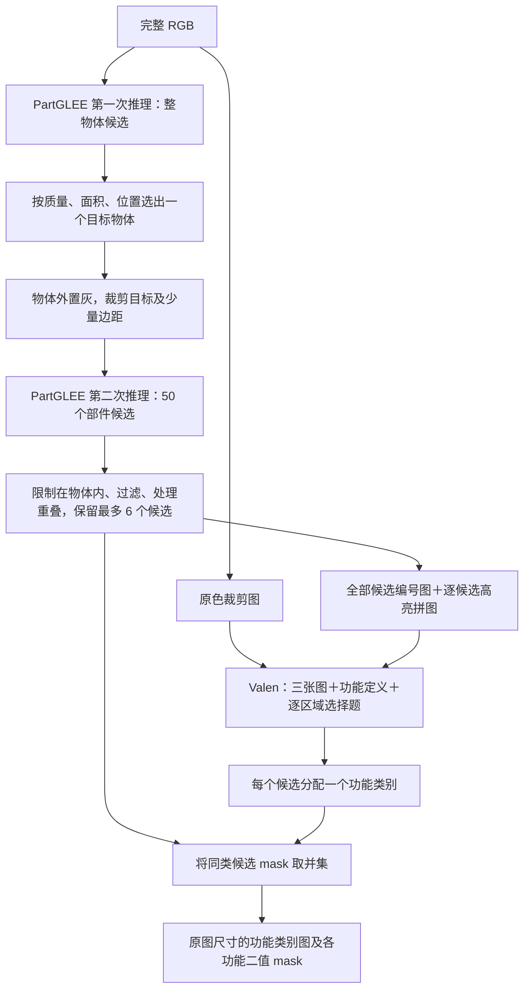

# PartGLEE＋Valen 整体框架

**核心思路：PartGLEE 提供部件边界，Valen 判断部件的功能类别，程序合并同类部件得到功能 mask。** 当前面向单个主要目标物体，UMD 实验使用 RGB，不使用深度或 GT 辅助正常推理。



## 1. 先确定目标物体与背景

PartGLEE 首次接收完整 RGB，产生 **50 个整物体候选**。mask 概率大于 0.5 的像素视为候选内部。

候选质量分数为：`类别 sigmoid 分数 × mask 内部平均 sigmoid 分数`。这是模型分数，不是实测 IoU。

排除质量分数低于 0.01、面积小于 64 像素的候选后，按以下规则选出一个：

```text
排序分数 = 质量 × √(候选面积 / 图像面积) × 中心位置权重 × 边缘惩罚
```

中心位置权重使用候选包围框中心，越靠近画面中心越大；碰到图像边缘时乘 0.1。该规则假设目标通常较完整且靠近中心，可能误选大面积背景。

- 选中 mask 内是当前目标前景，外部是背景；场景中的其他物体也可能被排除。
- 无合格候选时记录失败，不使用 GT 补救。
- 分割使用固定物体词表，包括 UMD 物体名称；不传入当前图片的真实物体类别。

## 2. 分割目标的部件

把目标 mask 外像素置为灰色 127，再按目标包围框裁剪。每侧额外边距为包围框较长边的 10%，受原图边界限制。

PartGLEE 第二次接收这个灰背景裁剪图，产生 **50 个允许相互重叠的部件候选**。使用统一部件词表，如 handle、blade、interior surface；这些部件名称不直接作为最终功能标签。

将候选映射回原图坐标，并与选中的目标物体 mask 取交集。第一步漏掉的物体区域，后续候选与 Valen 都无法补回。

## 3. 整理重叠候选

此时尚未判断功能类别。目标是得到数量较少、像素互斥的候选。

| 操作 | 当前规则 |
|---|---|
| 质量过滤 | 候选质量至少为 0.02 |
| 小区域过滤 | 连通块至少包含 `max(64, floor(物体面积 × 3%))` 个像素 |
| 重叠像素归属 | 分配给 `质量 / √(候选面积 / 物体面积)` 最大的候选 |
| 再次清理 | 分配后删除过小连通块；失效候选移除后重新分配 |
| 数量限制 | 超过 6 个时，逐次删除 `当前区域面积 × √质量` 最低的候选，再重新分配 |

最终得到最多 6 个互不重叠的 mask，编号为 1、2、3……。这一步是本项目的后处理，不是 PartGLEE 官方的全景分割输出。

**物体内部可能仍有未被任何候选覆盖的像素，不会强行补齐。** 当前 UMD 设置关闭“禁止整物体”限制，允许功能区域覆盖大部分或整个物体。

## 4. Valen 接收什么

具体使用 **Valen-4B**，接收同一帧生成的三个独立图片附件，以及功能定义和逐区域选择题：

| 图片 | 内容 | 用途 |
|---|---|---|
| 原色 RGB 裁剪图 | 原图按目标位置裁剪，保留原色及裁剪范围内的背景 | 判断真实形状、材质与内外表面 |
| 全部候选编号图 | 在同一裁剪图上叠加所有候选，颜色填充 45%，带描边与编号 | 对应区域编号、范围及相互位置 |
| 逐区域高亮拼图 | 每个小格保留整个物体，只高亮一个候选，最后拼成一张图 | 单独辨认各候选，减少标记遮挡 |

**Valen 的第一张图保留原背景；灰背景图用于 PartGLEE 的第二次分割。** 三张图来自同一个视角，不是三个独立样本。

当前 UMD 功能类别为：

`grasp / cut / scoop / contain / pound / support / wrap-grasp`

另外提供 `none` 拒选项。每个候选只能属于其中一类，颜色和编号没有预设功能含义。

例如有 6 个候选，就同时提出 6 个选择题：“区域 1 的主要功能是什么？”……“区域 6 的主要功能是什么？”所有问题共享图片上下文，Valen 一次前向计算输出各选项概率，不逐 token 生成解释或 mask。

## 5. 按功能合并 mask

对每个候选取概率最高的类别，再把同类候选做像素并集：

```text
候选 1 → grasp
候选 2 → cut
候选 3 → grasp

grasp mask = 候选 1 ∪ 候选 3
cut mask   = 候选 2
```

合并不要求区域相邻，也不填补空隙、扩张边界或重新分割。候选原本互斥且每个候选只有一类，因此最终每个像素最多只有一个功能类别。

输出与原始 RGB 像素对齐：

- `result/class_map.png`：类别 ID 图，0 为背景／未分配／none，1–7 为 UMD 功能类别。
- `result/masks/<类别>.png`：各类别的 0/255 二值 mask。
- `foreground/object_mask.png`、`regions/unassigned_foreground.png`、`result/masks/none.png`：分别保留物体范围、未覆盖前景和判为 none 的候选，便于区分三者。

## 6. “GT 多数类别”诊断使用哪组 mask

使用第 3 步整理完成、**交给 Valen 判断之前的那组候选**，保留它们的边界和数量，仅替换分类结果：

```text
整理后的候选 mask
    → 统计各候选内部 GT 像素的类别数量
    → 每个候选取数量最多的类别
    → 将同类候选取并集
    → 与 GT 比较
```

它既不使用全部 50 个原始候选，也不使用 Valen 已经按预测类别合并后的 mask。

该诊断包含 GT 背景类别，忽略 void（−1）；多数票并列时优先保留原预测类别，否则取最小类别 ID。未被候选覆盖的像素仍为 0。

在原始 dominant GT、2,661 张测试图上，对应 **mIoU 81.95%、gIoU 75.49%**。这是使用 GT 的分类替换诊断，不能作为模型成绩，也不是严格的 mIoU 上限。

[查看全部样本的 GT 多数类别结果](../outputs/umd_gt_majority_viewer/index.html)。

## 7. SFT 与 A/B/C 改动哪里

各方案固定同一套 PartGLEE 前景与候选，主要改变 Valen 的学习方式：

| 方案 | 改动 |
|---|---|
| 普通 SFT | 用 76 张训练图中候选的 GT 多数类别，训练决策头及语言模型 LoRA |
| A | 扰动编号、颜色、布局和定义表达；研究区域／定义配对与预测一致性 |
| B | 对候选做几何拆分／合并，加入组合监督；比较额外一致性约束 |
| C | 在三图输入基础上，显式提取目标候选特征；再研究邻近区域与整个物体的特征 |

A/B 的增强和辅助损失在训练阶段使用；推理仍按上述候选逐区分类。C 推理额外使用候选 mask 对第一张原色图的视觉 token 特征池化，但不修改候选边界。

原始零样本与 SFT 使用各自固定的功能定义：SFT 对混合候选强调选择占比最大的功能，二者配置分别为 `umd_affordances.json` 和 `umd_affordances_sft.json`。

具体结果见 [实验结果汇总](research/实验结果.md)。

## 代码与配置

| 环节 | 文件 |
|---|---|
| 两次 PartGLEE 推理与裁剪 | [segmentation/partglee.py](../src/affordance_jev/segmentation/partglee.py) |
| 目标物体排序 | [segmentation/foreground.py](../src/affordance_jev/segmentation/foreground.py) |
| 候选整理 | [segmentation/partition.py](../src/affordance_jev/segmentation/partition.py) |
| 三图请求、分类解析与合并 | [decision/regions.py](../src/affordance_jev/decision/regions.py) |
| 阈值、候选数量和词表 | [umd_pipeline.json](../configs/umd_pipeline.json) |
| 原始功能定义／SFT 功能定义 | [原始](../configs/umd_affordances.json) · [SFT](../configs/umd_affordances_sft.json) |
| GT 多数类别诊断 | [evaluation/diagnose.py](../src/affordance_jev/evaluation/diagnose.py) |
